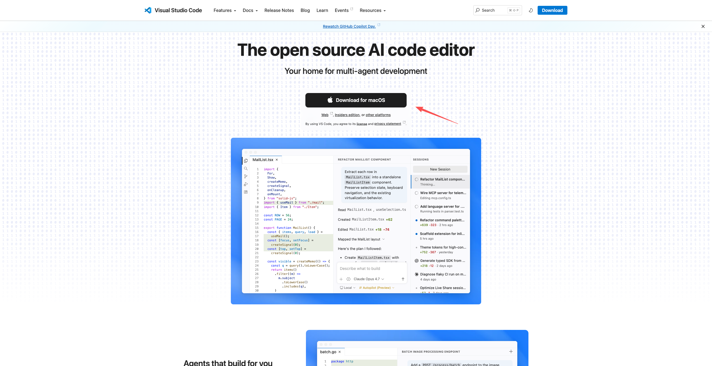
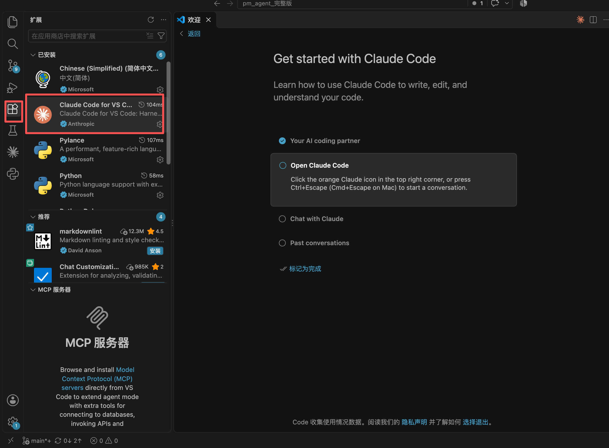
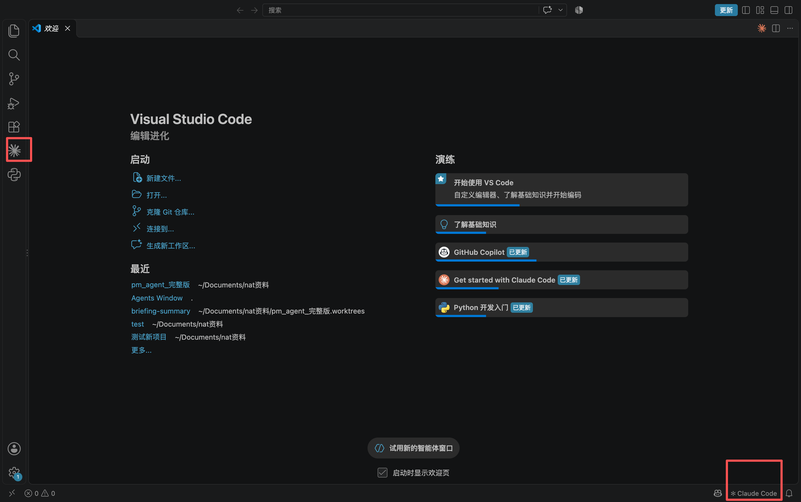
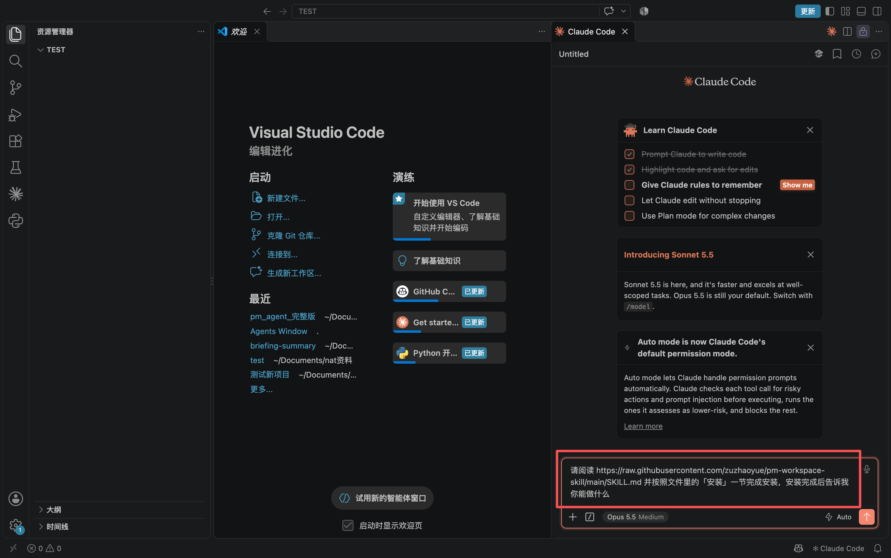
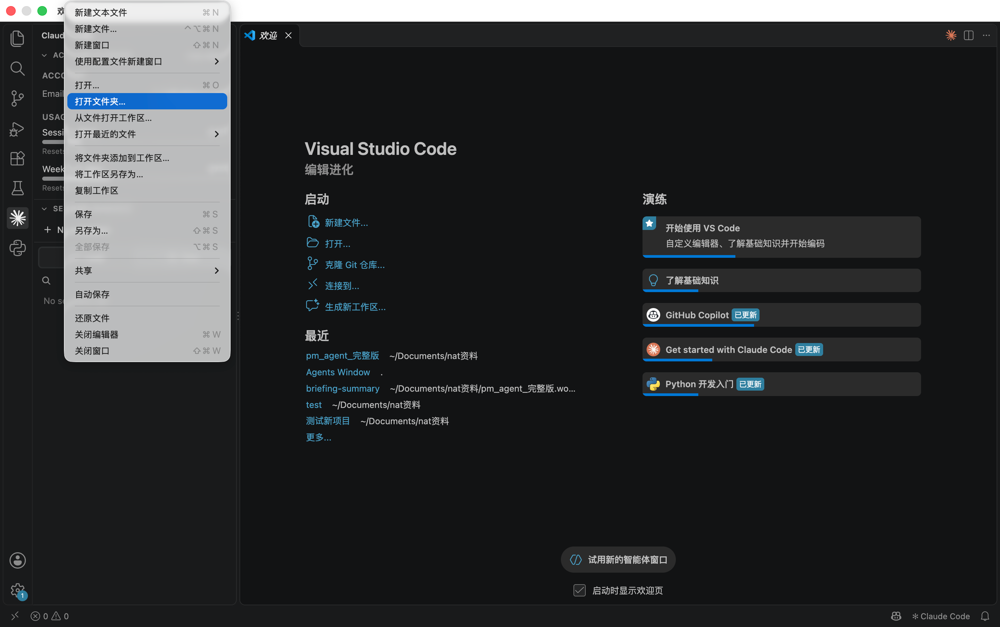
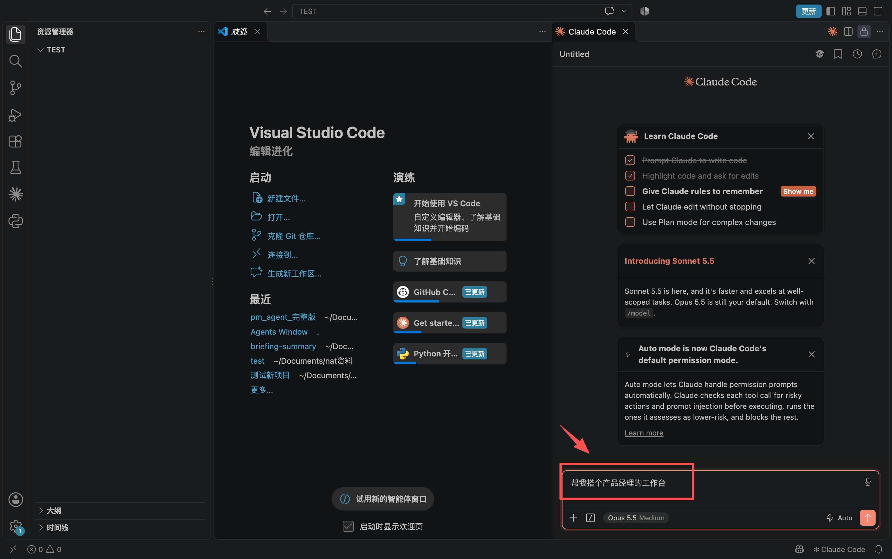
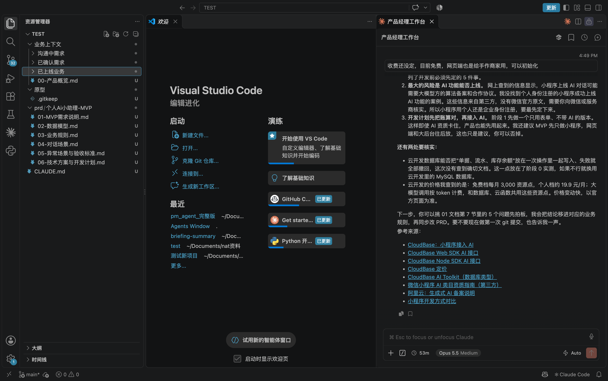

# 从零搭一个产品经理工作台

> 这篇教程假设你**从来没装过 VS Code、没用过 Claude Code**。
> 全程不需要写代码、不需要碰终端命令行。
> 跟着做完大约 **20 分钟**，其中大部分时间在等软件下载。

搭完之后你会得到一个文件夹，里面装着你产品的业务知识。以后在这个文件夹里跟 AI 说话，
它每次都会先读一遍你的规则和业务背景，再动手——不会每次都要你重新解释一遍产品是干嘛的。

---

## 开始之前：你需要一个付费订阅

⚠️ **Claude Code 需要 Pro / Max / Team / Enterprise 订阅，免费版用不了。**

没有的话先去 [claude.com/pricing](https://claude.com/pricing) 订一个。个人用 Pro 就够。

---

## 第 1 步 · 装 VS Code（约 5 分钟）

VS Code 是微软出的免费编辑器。你不用学它怎么写代码，**只是拿它当一个能让 AI 读写文件的壳**。

1. 打开 [code.visualstudio.com](https://code.visualstudio.com)
2. 点页面中间那个下载按钮（它会自动认出你是 Mac 还是 Windows）



> 按钮上会直接写你的系统（图里是 `Download for macOS`），不用自己挑版本。
3. 下载完双击安装：
   - **Mac**：解压出一个 `Visual Studio Code` 图标，**把它拖进「应用程序」文件夹**
   - **Windows**：双击安装包，一路下一步
4. 打开它。第一次会问你要不要装中文语言包、选主题，随便选，不影响后面

> 如果你电脑上已经有 VS Code，确认版本是 **1.94 或更新**（菜单栏 → Code/帮助 → 关于）。
> 太老的版本装不了下一步那个扩展。

---

## 第 2 步 · 装 Claude Code 扩展（约 2 分钟）

1. 在 VS Code 里按 **`Cmd+Shift+X`**（Mac）或 **`Ctrl+Shift+X`**（Windows）
   —— 左边会弹出「扩展」面板
2. 在搜索框里打 **`Claude Code`**
3. 找到 **Anthropic** 发布的那个（图标是一个八角星 ✻），点 **Install / 安装**



> 左边红框是「扩展」按钮的位置，中间红框是这个扩展长什么样。
> 你装完之后这里会显示「已安装」。

装完如果左边没出现那个星星图标，**重启一次 VS Code**。

> 不需要另外装什么 Node.js、也不需要装命令行工具——扩展自带，这是它比终端省事的地方。

---

## 第 3 步 · 登录（约 1 分钟）

1. 点 **VS Code 最左边那一竖条**（叫"活动栏"）里的 **✻ 星星图标**
   —— 找不到的话，看**右下角状态栏**有没有 `✻ Claude Code`，点它也行



> 两个红框点哪个都行。**右下角那个始终在**，左边那个有时候要往下翻。
2. 右边会开出一个面板，第一次会显示登录屏，点 **Sign in**

3. 浏览器会自动打开，用你的 Claude 账号授权，然后回到 VS Code

登录成功后会出现一个「Learn Claude Code」引导清单，可以直接点 X 关掉。

---

## 第 4 步 · 装工作台 skill（约 2 分钟）

这一步是把这套产品经理的工作方法装到你的电脑上。

1. **先随便打开一个文件夹**，不然 Claude 不知道在哪干活：
   菜单栏 **文件 → 打开文件夹**，选桌面上任意一个文件夹（哪个都行，这步跟后面无关）
2. 回到右边的 Claude 面板，在底部输入框里**粘贴这段话，回车**：

```
请阅读 https://raw.githubusercontent.com/zuzhaoyue/pm-workspace-skill/main/SKILL.md 并按照文件里的「安装」一节完成安装，安装完成后告诉我你能做什么
```



> 右边那一整条就是 Claude 面板，最底下红框就是输入框。
> 左边文件列表是空的没关系 —— 这一步只是装 skill，跟打开哪个文件夹无关。

3. 它会下载文件、写进你的用户目录，然后告诉你能做什么。
   中途可能弹窗问**「是否允许执行这条命令」，点允许**。

> 这一步选哪个文件夹都无所谓——skill 装在你的用户目录里，跟打开的文件夹没关系。

---

## 第 5 步 · 搭你的第一个工作区（约 10 分钟，大半是你在回答问题）

### 5.1 新建一个空文件夹

在电脑上（访达 / 文件资源管理器）新建一个文件夹，**名字就用你的产品名**，中文没问题。

⚠️ **必须是新的、空的** —— 它接下来会被装满知识库文件。

### 5.2 用 VS Code 打开它

菜单栏 **文件 → 打开文件夹** → 选中刚建的那个。



VS Code 会重开窗口，左边文件列表是空的——对的，马上就有了。

### 5.3 说一句话

在右边 Claude 面板的输入框里打：

```
帮我搭个产品经理的工作台
```



> 左边文件列表现在还是空的（图里是 `TEST` 文件夹），回车之后它就开始问你问题了。

### 5.4 回答它的问题

它会**先问你有没有现成的文档**（PRD、需求文档、竞品调研、会议纪要都行，
**直接把文件拖进对话框**就能给它）。没有也完全不影响。

然后**一次问你一个问题**，只有 3 个：

| # | 它问什么 | 答起来长这样 |
|---|---|---|
| 1 | 你的产品是什么？给谁用？怎么赚钱？ | 钉钉，企业办公协同平台，给中小企业的 HR 和行政用；基础版免费，专业版按人数收年费 |
| 2 | 有哪些端？分别谁在用？ | 员工手机 App + 管理后台（HR 用）+ PC 客户端 |
| 3 | **手上的功能分别在哪个阶段？** | 考勤打卡=已上线；审批流自定义=定了等排期；AI 会议纪要=还在聊 |

**答不上来的直接说「跳过」**，它不会瞎编——没讲过的地方会老老实实写「(待填)」。

<!-- 截图待补： -->

**第 3 题最重要**，它决定每个功能被放进哪个文件夹，也就决定了以后 AI 会不会把
「还在聊的」当成「已经有的」去答客户。

### 5.5 搭好了

左边文件列表会出现：

```
你的产品/
├── CLAUDE.md            AI 每次干活前必读：协作方式 + 知识维护规则 + 当前状态
├── 项目跟进.md          排期、负责人、风险、待办（不记业务口径）
├── 业务上下文/
│   ├── 00-产品概览.md    产品是什么、端划分、功能索引
│   ├── 已上线业务/       线上现在的实际行为，能直接答客户
│   ├── 已确认需求/       规格定了、等排期 —— 但不是线上现状
│   └── 沟通中需求/       还在聊，口径会变
├── prd/
└── 原型/
```

**这三个文件夹是整套方法的地基**：功能的状态不写在文件里，写在**文件夹**上。



> **左边**就是刚搭好的知识库：`业务上下文/` 下那三个状态文件夹、`00-产品概览.md`、
> `CLAUDE.md` 都在。图里 `prd/` 下面已经有文件了，那是**用了一阵之后**的样子 ——
> 你刚搭完的时候 `prd/` 和 `原型/` 都是空的。
>
> **右边**是接着干活的样子：它读完知识库在跟你讨论需求，
> 结论会落回左边对应的文件里。
功能上线了，整套文件换文件夹。

---

## 之后每天怎么用

打开这个文件夹，在 Claude 面板里直接说人话就行：

| 你说 | 它做什么 |
|---|---|
| 「XX 功能的规则是什么？」 | 先看它在哪个文件夹，再答你，并告诉你算不算线上现状 |
| 「把 XX 规则改成…」 | 改业务规则文件，并提醒你哪些地方要跟着同步 |
| 「帮我写 XX 的 PRD」 | 先读业务规则，信息不全会一问一答跟你确认 |
| 「XX 这条口径定下来了」 | 从待确认清单移进业务规则 |
| 「XX 上线了」 | 提醒你整套文件换文件夹 |

它会自动守的规矩（你不用每次提）：

- 动笔前先读产品概览，确认功能在哪个上线状态文件夹
- **不得基于猜测撰写**，没确认的标【待确认】并配一个通俗事例
- 一问一答，一次只问一个问题
- 不删你的文件、不覆盖原始材料

---

## 出问题怎么办

| 现象 | 原因 / 怎么办 |
|---|---|
| 扩展装完左边没有星星图标 | 重启 VS Code |
| 点开面板一直让你登录 | 命令面板（`Cmd+Shift+P`）搜 **Developer: Reload Window** |
| 说了「帮我搭个产品经理的工作台」没反应 | 多半是你这台机器以前从没装过 skill。输入 `/reload-skills` 再试；还不行就新开一个会话 |
| 它说「这个目录已经初始化过了」 | 你选的文件夹里已经有 `CLAUDE.md`。**这是故意拦你的**，防止覆盖已有项目 —— 新建一个空文件夹再来 |
| 它开始编造你没说过的业务规则 | 不该发生。截图发给我，这是 skill 的 bug |

---

## 这套东西到底在解决什么

产品经理的业务知识散在飞书文档、微信聊天、和脑子里。于是：

- 同一条口径，今天问 AI 和明天问 AI，答案不一样
- **把「还在聊的方案」当成「线上已有的功能」**去答客户、去排开发 —— 这个错最贵
- PRD 改了知识库没改，下次又按旧口径写

这套工作台不会替你做产品判断。**它保证的是：你做过的判断不会被记错、记丢、记乱。**
